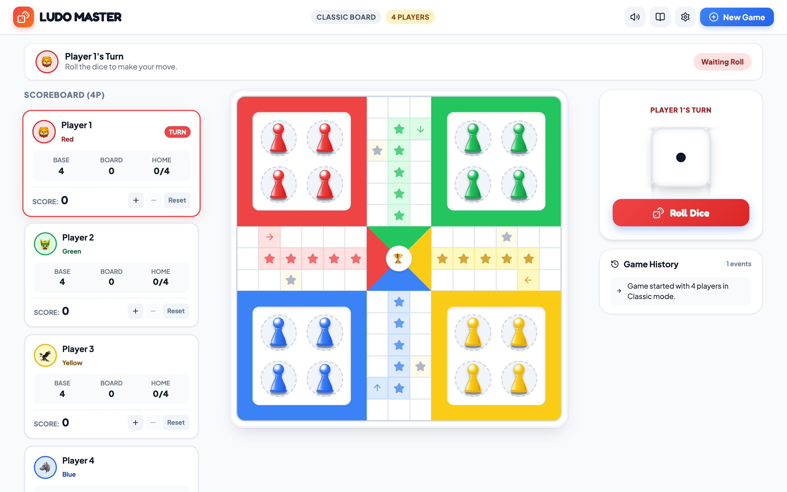
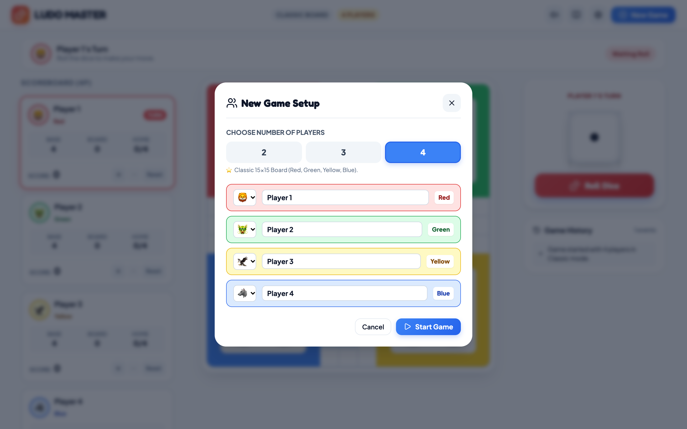
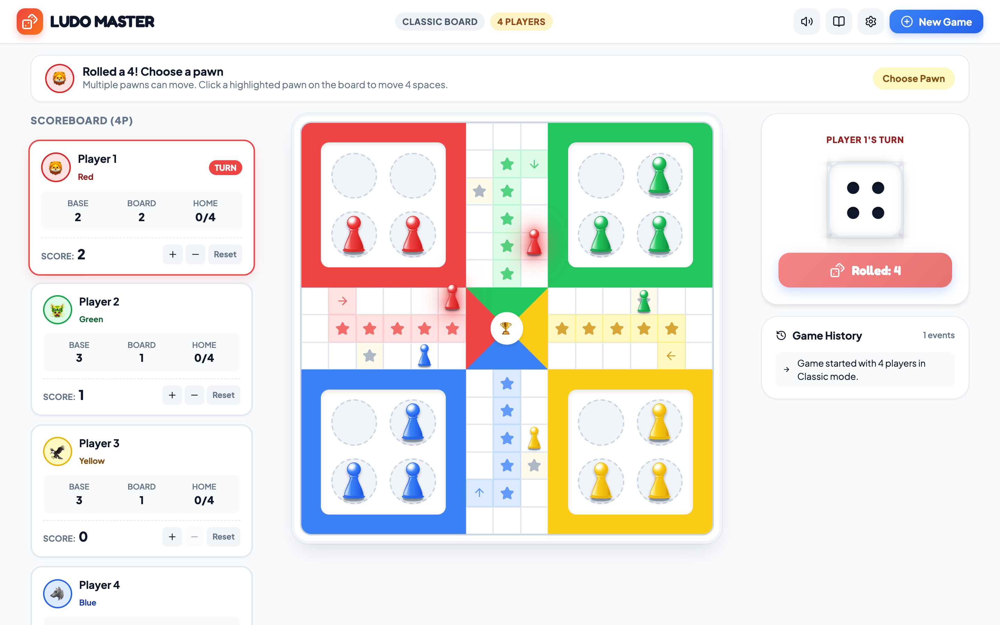
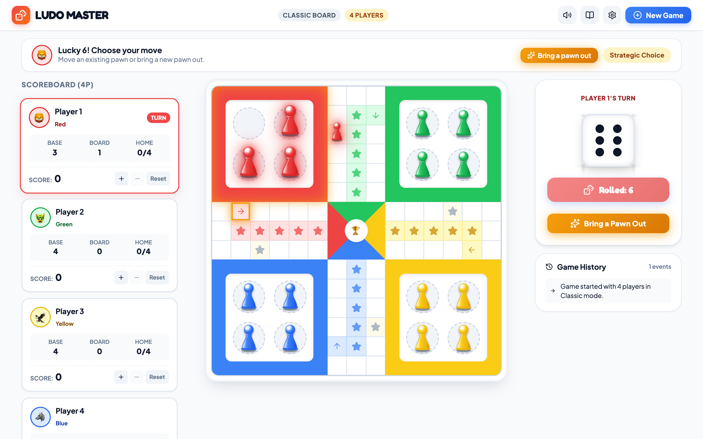
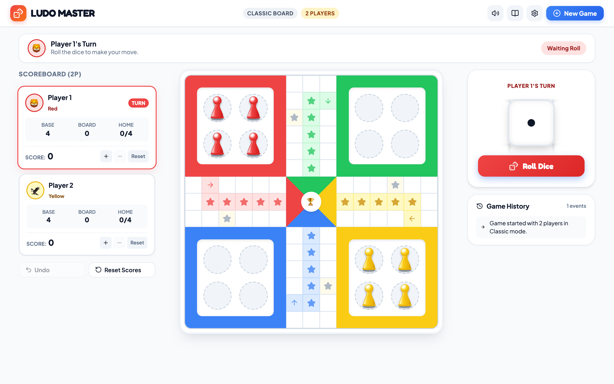
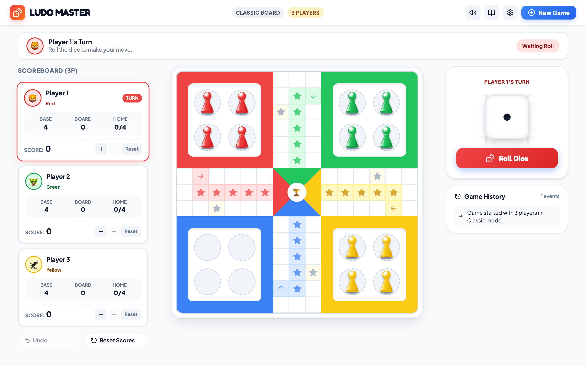

# 🎲 Ludo Master — Royal Casual Board Game

A complete, production-quality, responsive single-page Ludo board game built with **React**, **Vite**, and **JavaScript**, supporting **2, 3, and 4 local players** on the authentic, traditional **Classic 15×15 Board**.



---

## 📸 Screenshots Gallery

All screenshots below are captured directly from the live running application in a high-resolution browser viewport.

### 1. Main Game (4 Players)
The primary classic 15×15 board featuring all four colored quadrants (Red, Green, Yellow, Blue), the live Scoreboard, 3D animated dice panel, and recent move history.


---

### 2. New Game & Player Setup
Configure 2, 3, or 4 local players, assign custom player names, choose personal avatars from the emoji picker, and verify color allocations.



---

### 3. Gameplay in Progress
Real interactive gameplay with pawns traversing the circuit. Highlighting movable pieces, active turns, and real-time piece tracking on the scoreboard.



---

### 4. Strategic Choice & Piece Selection
When rolling a 6 with pawns both on the board and in the base, players are presented with a clear strategic decision: advance an active track pawn or use the **"✨ Bring a Pawn Out"** action.



---

### 5. Victory Celebration
When a player finishes all 4 pawns in the central home triangle, a triumphant celebration modal displays the champion with multi-angle confetti animations and options for a rematch or new game.


---

### 6. 2-Player Game Mode
A dedicated 2-player configuration utilizing diagonally opposite bases (Red and Yellow) for classic competitive balance, with inactive bases cleanly rendered.



---

### 7. 3-Player Game Mode
A 3-player configuration utilizing Red, Green, and Yellow quadrants with balanced spacing and full scoreboard tracking.



---

## ✨ Features & Highlights

### 🎮 Flexible Game Modes (2, 3, & 4 Players)
- **Traditional 15×15 Ludo Grid:** Standard 52-cell track with 4 colored home bases (Red, Green, Yellow, Blue), 8 safe squares, 4 colored home lanes, and central finish.
- **Player Customization:** Customize player names, pick from 12 avatars (🦁, 🐺, 🐲, 🦅, 🦄, 🐯, etc.), and view dynamic player status cards.

### ♟️ Realistic 3D Ludo Pawns
- **Board-Game Silhouette:** Beautifully contoured plastic pawn silhouette featuring a spherical head with specular gloss reflection, narrow neck collar, bell body, stepped circular pedestal base, and contact drop shadow.
- **Vibrant Color Schemes:** Hand-crafted gradients and border styling for Red, Green, Yellow, and Blue pawns.
- **Interactive Visual States:**
  - *Normal:* Sits centered in its board pocket with a soft grounding shadow.
  - *Selectable:* Glowing aura and rhythmic bounce hop animation (`pawnHopBounce`).
  - *Jumping Arc:* Springy step-by-step jump animation (`pawnJumpMove`) with dynamic shadow elevation.
  - *Stacking Badge:* High-contrast count badge when multiple pawns share a safe square.

### 🕹️ Strategic Choice & Smooth Movement
- **Strategic Decision on 6:** When rolling a 6 with pawns waiting in base and pawns on the track, the player chooses whether to advance a board piece or bring out a new pawn.
- **Intelligent Single-Move Auto-Execution:** When only one legal strategic move exists, the engine automatically moves the piece, eliminating repetitive clicks.
- **Configurable Movement Speed:** Choose between **Slow** (350ms), **Normal** (Default, 260ms), and **Fast** (190ms) in Settings, with automatic respect for reduced-motion accessibility preferences.
- **Captures & Safe Squares:**
  - Opponents landing on regular track squares capture enemy pawns and send them back to base.
  - Star-marked cells (★) and starting squares are safe zones where pieces cannot be captured.
- **Home Lane & Exact Finish:** Pawns enter their dedicated colored home lane, requiring an exact roll to land on the center trophy.
- **Bonus Turns:** Awarded automatically on rolling a 6, capturing an opponent, or finishing a pawn.

### 📊 Scoreboard, Manual Scoring & Full Undo
- **Live Scoreboard:** Real-time counters showing pawns *In Base*, *On Board*, and *Finished (X/4)*.
- **Manual Score Tracking:** Quick `+1`, `-1`, and `Reset` buttons per player.
- **Global Reset Protection:** Modal confirmation before wiping scoreboard points.
- **Full Snapshot Undo:** Instant undo functionality that restores board pieces, active player, dice state, and history.

### 🔊 Synthesized Web Audio API Sound Effects
- Runs 100% offline with zero external audio assets!
- Synthesizes realistic 3D dice rattles, pawn hop sounds, capture booms, finish arpeggios, and victory fanfare.
- Sound toggle persisted in `localStorage`.

---

## 📜 Official Gameplay Rules

1. **Leaving Base:** A pawn requires a roll of **6** to exit its home base pocket and enter the starting square.
2. **Turn Progression:** Players take turns rolling the dice in clockwise order (Red → Green → Yellow → Blue).
3. **Extra Turns:** A player earns an immediate extra roll when:
   - Rolling a **6**
   - Capturing an opponent's pawn
   - Successfully reaching the center finish
4. **Captures:** Landing on an opponent's pawn on any regular track cell captures it and sends it back to its owner's base.
5. **Safe Squares:** Starting cells and squares marked with a star (★) are safe zones. Pawns on safe squares cannot be captured, and multiple pawns can safely share them.
6. **Winning:** Pawns must enter their player's colored home lane and land on the center finish with an **exact dice roll**. The first player to finish all **4 pawns** wins the game!

---

## 🛠️ Technologies Used

- **React 19:** Functional components, hooks (`useReducer`, `useMemo`, `useCallback`, `useRef`, `useEffect`).
- **Vite 6:** Lightning-fast HMR and optimized production build bundling.
- **Lucide React:** Modern, accessible SVG icons.
- **Canvas-Confetti:** High-performance celebratory particle effects.
- **Web Audio API:** Native browser-synthesized audio effects without external MP3 files.
- **Vitest & React Testing Library:** Unit, geometry, and end-to-end integration test suites.
- **Puppeteer-Core:** Headless browser automation for crisp high-resolution screenshot generation.

---

## 📁 Project Structure

```text
Mini Project - Ludo/
├── docs/
│   └── screenshots/              # High-resolution application screenshots
│       ├── main-game-4-player.png
│       ├── new-game-setup.png
│       ├── game-2-player.png
│       ├── game-3-player.png
│       ├── gameplay-in-progress.png
│       ├── piece-selection.png
│       └── winner-screen.png
│
├── public/
│   └── dice.svg                  # Application favicon & vector assets
│
├── scripts/
│   └── captureScreenshots.js     # Puppeteer script for generating documentation screenshots
│
├── src/
│   ├── components/               # Pure presentation UI components
│   │   ├── BoardCell.jsx         # 15x15 classic cell with safe stars & start arrows
│   │   ├── ConfirmModal.jsx      # Confirmation dialog for score resets
│   │   ├── Dice.jsx              # 3D animated dice with pips and roll controls
│   │   ├── GameBoard.jsx         # Classic 15x15 Ludo board with 4 colored bases
│   │   ├── GameControls.jsx      # Undo, Reset Scores, and Rules quick actions
│   │   ├── GameStatus.jsx        # Dynamic turn, roll, and event banner
│   │   ├── Header.jsx            # Top navbar, badges, sound toggle, new game
│   │   ├── Piece.jsx             # 3D contoured pawn piece with realistic shadows
│   │   ├── PlayerCard.jsx        # Player status, piece counters, and score controls
│   │   ├── PlayerSetupModal.jsx  # New game configuration modal (2-4 players)
│   │   ├── RecentMoves.jsx       # Event history log
│   │   ├── RulesModal.jsx        # Complete game rules modal
│   │   ├── SettingsModal.jsx     # Movement speed and audio settings
│   │   └── WinnerModal.jsx       # Victory celebration and rematch dialog
│   │
│   ├── game/                     # Headless Game Engine
│   │   ├── boardLayouts.js       # Mathematical 15x15 grid, cells, and paths
│   │   ├── captures.js           # Capture logic and safe square validation
│   │   ├── constants.js          # Player colors, cell types, default rules
│   │   ├── gameEngine.js         # Unified engine exports
│   │   ├── gameReducer.js        # Predictable state reducer with snapshot undo stack
│   │   ├── gameUtils.js          # Piece initialization and game state factory
│   │   ├── movement.js           # Legal move calculations, path tracking, overshoot checks
│   │   └── turnManager.js        # Turn rotations, bonus rolls, winning detection
│   │
│   ├── hooks/
│   │   ├── useGame.js            # Main game state hook and animation timer controller
│   │   ├── useLocalStorage.js    # Persistent settings storage hook
│   │   └── useSound.js           # Web Audio API sound synthesizer
│   │
│   ├── styles/
│   │   ├── board.css             # Board grid layout and realistic 3D pawn styles
│   │   ├── components.css        # Modals, player cards, dice, buttons, and animations
│   │   └── global.css            # CSS design tokens, typography, and resets
│   │
│   ├── App.jsx                   # Top-level application orchestrator
│   └── main.jsx                  # React DOM root entrypoint
│
├── tests/                        # Vitest automated test suite (57 tests)
│   ├── app.integration.test.jsx  # Full UI integration & modal workflow tests
│   ├── automove.test.js          # Automatic movement and roll-6 decision tests
│   ├── board.test.js             # 15x15 grid geometry and path connectivity tests
│   ├── captures.test.js          # Track captures and safe square protection tests
│   ├── movement.test.js          # Legal move calculations and exact finish tests
│   ├── pawn.test.jsx             # Pawn rendering and interactive state tests
│   ├── scoreboard.test.js        # Scoreboard tracking and manual adjustment tests
│   ├── turns.test.js             # Turn rotations and bonus turn tests
│   └── winning.test.js           # Winner detection and 4-piece finish tests
│
├── package.json
└── vite.config.js
```

---

## 🚀 Getting Started

### Prerequisites

- **Node.js**: v18.0.0 or higher
- **npm**: v9.0.0 or higher

### Installation

1. Clone the repository:
   ```bash
   git clone https://github.com/VinitSurve/ludo.git
   cd ludo
   ```

2. Install dependencies:
   ```bash
   npm install
   ```

### Running Locally

Start the Vite development server:
```bash
npm run dev
```

Open your browser and navigate to `http://localhost:5173/`.

### Running Tests

Execute the complete Vitest test suite:
```bash
npm test
```

To run tests in watch mode:
```bash
npm run test:watch
```

### Building for Production

Compile and bundle the production-ready application:
```bash
npm run build
```

Preview the production build locally:
```bash
npm run preview
```

---

## 🔮 Realistic Future Improvements

- **Computer AI Opponents:** Add rule-based AI bots with selectable difficulty levels (Easy, Medium, Aggressive) for solo play.
- **Online Multiplayer:** Add WebRTC peer-to-peer room matchmaking for remote cross-device play.
- **Custom Board Skins:** Provide alternate board aesthetic themes (e.g. Traditional Wooden Board, Modern Dark Neon, or Royal Marble).
- **Stat Tracking:** Track player win/loss records across sessions in local storage.

---

## 📄 License

This project is created for educational and academic submission purposes.
